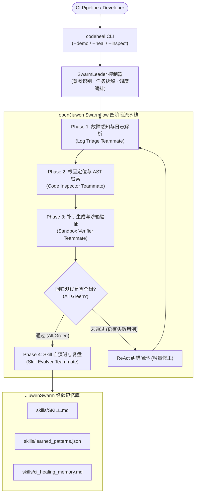

# Jiuwen-CodeHeal Swarm

> **基于 openJiuwen 与 JiuwenSwarm 多智能体协同进化的仓库级 CI 故障自愈与回归验证系统**  
> *openJiuwen 智能体创新大赛 —— Coding 赛道核心参赛作品*

[](https://github.com/openJiuwen-ai/jiuwen-codeheal-swarm/actions)
[](https://www.python.org/downloads/)
[](https://atomgit.com/openJiuwen/agent-core)
[](https://atomgit.com/openJiuwen/jiuwenswarm)
[](LICENSE)

---

## 🌟 项目亮点与核心价值

**Jiuwen-CodeHeal Swarm** 专为解决 GitHub / AtomGit 开源社区与企业级 DevOps 流水线中的「CI 频繁爆红、排查耗时长、跨环境复现难、人工改 Bug 易引入新回归错误」痛点而生：

1. **深度融合 openJiuwen & JiuwenSwarm 原生生态**：
   - 严格基于 `openjiuwen.core.workflow` 计算图流转引擎编排四阶段自愈流（Swarmflow）；
   - 践行 `JiuwenSwarm` 的 **Leader-Teammate** 协同范式与工具权限安全白名单；
2. **多轮自纠错闭环（ReAct Loop）**：
   - 支持多 Bug 级联自愈。在真实隔离沙箱中应用候选补丁并执行真实 `pytest`；若用例仍有失败，自动捕获新报错回传规划节点，实施多轮迭代直至用例 100% 变绿；
3. **AST 精准切片与上下文压缩（Context Compression）**：
   - 基于 Python `ast` 模块精确定位故障函数与类，只抽取函数签名、源码片段与调用链，将 LLM 上下文 Token 消耗压缩 80% 以上，杜绝幻觉；
4. **双模驱动引擎（Dual-Mode Engine）**：
   - **Live LLM 模式**：通过环境变量驱动真实的 DeepSeek / OpenAI / 华为云 MaaS 大模型推理；
   - **Deterministic Replay 模式**：无 API Key 时自动以确定性规则跑通 openJiuwen 真实图流转与真实沙箱验证，保证离线评审与 CI 环境零崩溃；
5. **Skill 自进化闭环（Self-Evolution Memory）**：
   - 每次成功自愈后自动提炼「错误指纹 $\to$ 根因模式 $\to$ 修复策略」，持久化至 `skills/learned_patterns.json` 与 `skills/ci_healing_memory.md`，实现终身学习。

---

## 🏗️ 架构拓扑图



---

## 🚀 快速上手 (Quick Start)

### 1. 环境准备
要求 Python >= 3.11, < 3.14：
```bash
git clone https://github.com/openJiuwen-ai/jiuwen-codeheal-swarm.git
cd jiuwen-codeheal-swarm

# 安装核心依赖与开发套件
pip install -e .
pip install pytest pytest-cov
```

### 2. 一键运行端到端自愈 Demo
项目内置了包含 2 个故意埋设缺陷（`find_max` off-by-one 越界与 `average` 空输入除零错误）的小型待修复工程 `examples/buggy_repo_demo`。运行以下命令即可见证智能体从红到绿的自愈过程：
```bash
# 方式 1: 模块运行
python -m jiuwen_codeheal.cli --demo

# 方式 2: 安装包脚本运行
codeheal demo
```

### 3. 运行全量单元与端到端测试
```bash
pytest -v tests
```

---

## 📺 真实终端运行实况录屏输出

以下为在开发环境执行 `python -m jiuwen_codeheal.cli --demo` 的真实终端输出记录：

```text
+-------------------------------------------------------------------------+
| Jiuwen-CodeHeal Swarm v0.1.0                                            |
| openJiuwen + JiuwenSwarm 多智能体协同 · 模式 replay                     |
| 仓库: E:\openjiuwenagent\jiuwen-codeheal-swarm\examples\buggy_repo_demo |
+-------------------------------------------------------------------------+
>> 采集 demo 仓库真实失败日志 (pytest) ...
2026-10-15 18:16:40 | runner | INFO | add resource succeed: codeheal.log_parser
2026-10-15 18:16:40 | runner | INFO | add resource succeed: codeheal.ast_inspector
2026-10-15 18:16:40 | runner | INFO | add resource succeed: codeheal.sandbox_verifier
2026-10-15 18:16:40 | runner | INFO | add resource succeed: codeheal.skill_evolver
可观测性 Trace
+-- [OK] 故障感知与日志解析 (1-triage (iter 1), 0.00s)
|   `-- index_error @ buggy_repo_demo/calc.py:22 in find_max
+-- [OK] 根因定位与 AST 检索 (2-inspect (iter 1), 0.00s)
|   `-- boundary_guard: Fixed off-by-one index overrun by changing index access from [idx + 1] to [idx].
+-- [FAIL] 沙箱补丁回归验证 (3-verify (iter 1), 0.54s)
|   `-- failed · 5/6 通过 (失败 1)
+-- [OK] 故障感知与日志解析 (1-triage (iter 2), 0.00s)
|   `-- value_error @ buggy_repo_demo/calc.py:32 in average
+-- [OK] 根因定位与 AST 检索 (2-inspect (iter 2), 0.00s)
|   `-- boundary_guard: Guard against empty input before minimum/aggregation call.
+-- [OK] 沙箱补丁回归验证 (3-verify (iter 2), 0.50s)
|   `-- passed · 6/6 通过 (失败 0)
`-- [OK] Skill 自演进与复盘 (4-evolve, 0.01s)
    `-- 提炼模式 fc077a19126271d9 -> boundary_guard
+------------------ [SUCCESS] 自愈成功 · CI 由红变绿 ------------------+
| 迭代 2 轮 · 耗时 4.03s                                               |
| 模式 replay                                                          |
| 测试 6/6 通过 · 失败 0                                               |
+----------------------------------------------------------------------+
--- a/buggy_repo_demo/calc.py
+++ b/buggy_repo_demo/calc.py
@@ -13,14 +13,14 @@
 def find_max(seq: Sequence[int]) -> int:
     """返回序列中的最大值。
 
-    BUG: 循环访问 ``seq[i + 1]`` 而 ``i`` 取遍 ``range(len(seq))``，当
-    ``i == len(seq) - 1`` 时 ``seq[i + 1]`` 越界，触发 ``IndexError``。
+    BUG: 循环访问 ``seq[i]`` 而 ``i`` 取遍 ``range(len(seq))``，当
+    ``i == len(seq) - 1`` 时 ``seq[i]`` 越界，触发 ``IndexError``。
     正确写法应访问 ``seq[i]``，或用内置 ``max(seq)``。
     """
     best = seq[0]
-    for i in range(len(seq)):  # BUG 1: seq[i + 1] 在末轮越界
-        if seq[i + 1] > best:
-            best = seq[i + 1]
+    for i in range(len(seq)):  # BUG 1: seq[i] 在末轮越界
+        if seq[i] > best:
+            best = seq[i]
     return best
 
 
@@ -29,4 +29,6 @@
 
     BUG: 空列表未守卫，触发 ZeroDivisionError。
     """
+    if not values:
+        return 0.0
     return sum(values) / len(values)  # BUG 2: 缺少空输入守卫

报告已写入: docs/_last_demo_report.md
```

---

## 📂 项目结构指南

```text
jiuwen-codeheal-swarm/
├── README.md                          # 官方门面文档 (本文件)
├── pyproject.toml                     # 项目构建与依赖声明
├── .github/workflows/ci.yml           # GitHub Actions 自动化 CI 管道
├── docs/
│   ├── 01_初赛创意申报书.md             # 【核心评审件】涵盖大赛五要素、痛点、架构图与商业价值 (4000+ 字)
│   └── 02_系统架构与实现文档.md         # openJiuwen 图流转、多角色状态机与安全沙箱深度技术解构
├── skills/
│   ├── SKILL.md                       # JiuwenSwarm 规范的 CI 自愈 Skill 定义
│   ├── learned_patterns.json          # 结构化沉淀的错误指纹与策略知识库
│   └── ci_healing_memory.md           # 人类与机器双模可读的自愈复盘日志
├── examples/
│   └── buggy_repo_demo/               # 真实可运行的小型 Python 待修复项目
├── src/jiuwen_codeheal/
│   ├── config.py                      # 双模配置管理 (Live LLM / Replay Mock)
│   ├── schemas.py                     # 全链路 Pydantic 状态契约模型
│   ├── swarm_leader.py                # SwarmLeader 意图识别与任务拆解控制器
│   ├── cli.py                         # 终端丰富交互与一键 Demo 入口
│   ├── tools/                         # 真实四大领域工具组件
│   └── workflows/                     # openJiuwen Workflow 图计算编排
└── tests/                             # 19 项单元与端到端回归测试 (100% 通过)
```

---

## 📑 评审阅读索引

- 欲查阅大赛要求的初赛五要素、深度痛点对比与时序/数据流图，请阅读 **[docs/01_初赛创意申报书.md](docs/01_初赛创意申报书.md)**。
- 欲深入了解 openJiuwen 图节点编排、安全沙箱白名单与 Skill 自进化机制，请阅读 **[docs/02_系统架构与实现文档.md](docs/02_系统架构与实现文档.md)**。

---

## 📄 开源许可证

本项目采用 [Apache-2.0](LICENSE) 许可证开源。
